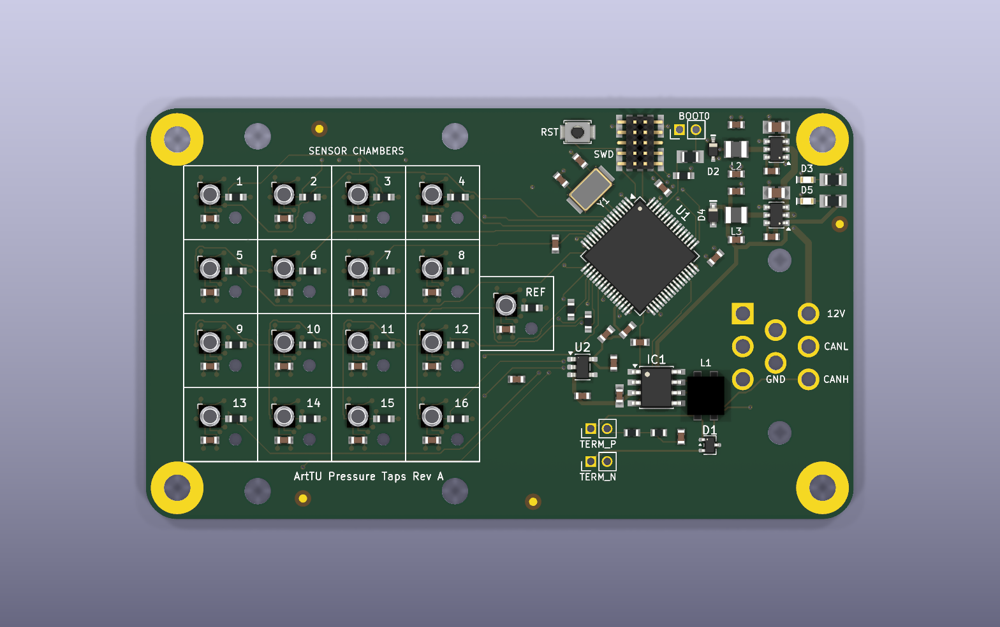
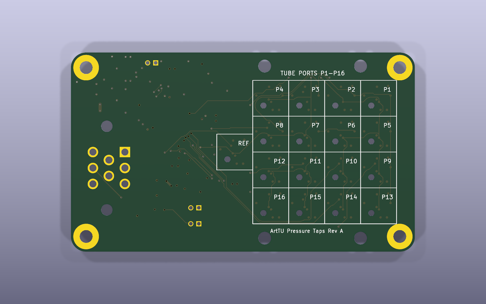
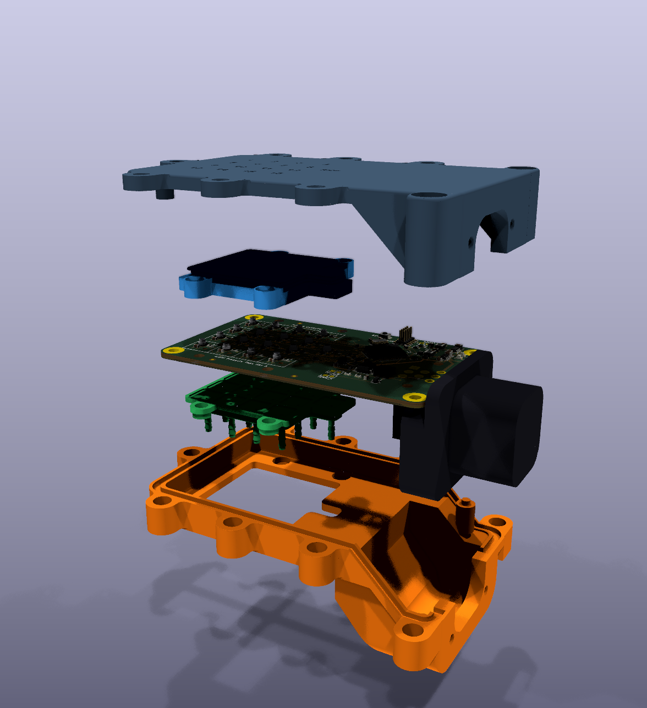
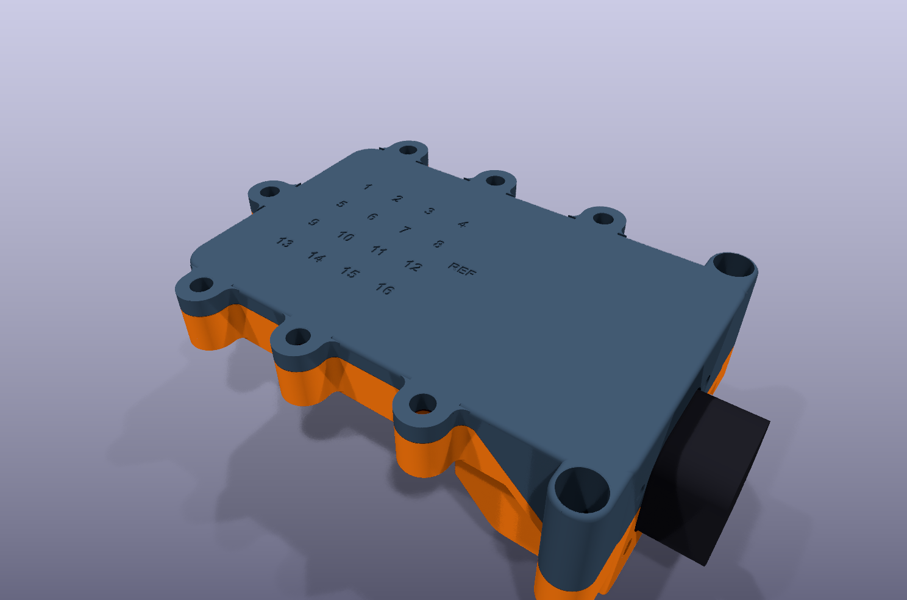

# Pressure Taps

A 16-channel aero pressure tap board for ArtTU. It reads 16 pressure ports and one reference port over SPI and sends the data out on CAN. The sensors sit in sealed chambers, with a glued cover on top and a tube block underneath.

| | |
|---|---|
| Board size | 86 × 50 mm, 1.6 mm thick, 4 layers |
| Layers | Top, GND plane, GND+PWR (3V3) plane, bottom |
| MCU | STM32G483RET6 |
| Sensors | 17 × LPS27HHW (16 taps and 1 reference) on one SPI bus |
| Supply | 12 V in, 5 V and 3.3 V on board |
| Bus | CAN through a TJA1441, with switchable termination on P3 and P4 |
| Connector | TE Ampseal 2489696-1, 8 pin |
| Design tool | KiCad 10 |

> **Status:** this design passes KiCad's electrical and layout checks. This repository has no test results from a built board.

## The board

**Top side:** sensors on the left, MCU in the middle, CAN below it and the two regulators stacked in the top right corner. SWD, reset and BOOT0 are in a row along the top edge.



**Bottom side:** tube port labels and the Ampseal connector.



The sensor grid is centred top to bottom: 7.0 mm from the grid to each long edge. The clamp holes H5 to H8 are centred on the same line.

## Schematic

The full schematic is in [docs/schematic.pdf](docs/schematic.pdf). It has five sheets:

| Sheet | Contents |
|---|---|
| MCU | U1, BOOT0, reset, clock, SPI series resistors, MCU power and the VDDA regulator |
| Communication | CAN transceiver, choke, termination and ESD protection |
| Connectors | SWD header, Ampseal connector, mounting holes and fiducials |
| Power | 5 V and 3.3 V regulators, power flags |
| Sensors | The 17 pressure sensors and bulk capacitor |

The schematic style and part choices follow the ArtTU Gateway boards. Footprints named `GW_*` use pads measured from CAN_Gateway RevA.

## Ampseal pinout

| Pin | Signal |
|---|---|
| 1 to 4 | Not connected |
| 5 | GND |
| 6 | 12 V |
| 7 | CAN_N |
| 8 | CAN_P |

## Enclosure

The press-fit enclosure is in [mechanical/press_fit](mechanical/press_fit). It has four printed parts: case top, case bottom, sensor cover and tube block. STEP and STL files are in that folder.





To rebuild the parts, run this from the repository root:

```bash
uv run --no-project --python 3.12 --with cadquery==2.8.0 python -I mechanical/press_fit/enclosure.py mechanical/press_fit
```

The board size and hole positions in `enclosure.py` must match the PCB. Change both together.

## Bill of materials

The BOM is in [PressureTaps_BOM.csv](PressureTaps_BOM.csv). Parts shared with the Gateway use the same part numbers, manufacturers and suppliers.

## Open items

- R20 and R21 (33 Ω, SPI series resistors) have no part number yet.
- The P2, P3 and P4 pin headers do not fit under the case lid.
- D1 uses a standard SOT-323 footprint. The Gateway footprint for the same part has wider pad spacing, so it was not copied. Check it against the datasheet drawing.
